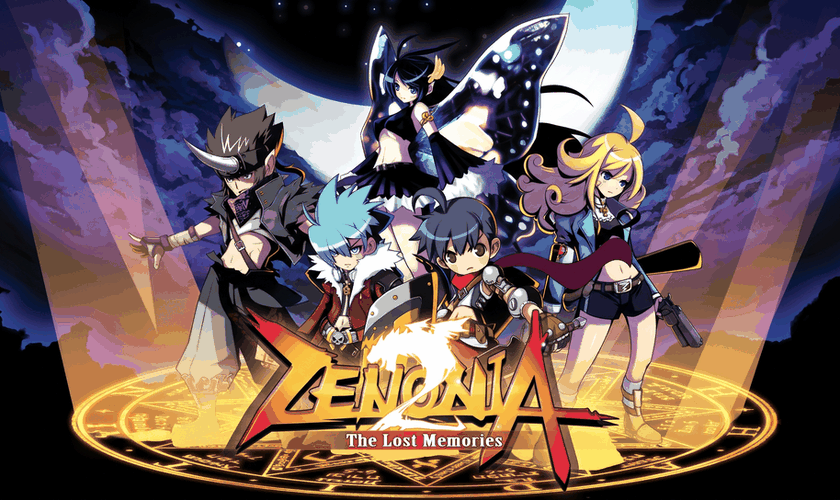

<h1 align="center">
  <br>
  Zenonia 2 · PS Vita Port
</h1>

<p align="center">
  <b>Native port of Zenonia 2: The Lost Memories (Gamevil) for PlayStation Vita and PlayStation TV.</b>
</p>

<p align="center">
  
  
  
  
  
  
</p>

<p align="center">
  <a href="#-description">Description</a> •
  <a href="#-features">Features</a> •
  <a href="#-controls">Controls</a> •
  <a href="#-installation">Installation</a> •
  <a href="#-known-issues">Known Issues</a> •
  <a href="#-building-from-source">Build</a> •
  <a href="#-credits">Credits</a>
</p>

---

## 📖 Description

ZENONIA® 2: The Lost Memories has been highly enhanced in every aspect compared to the original. Full character and control
customization, four characters following individual epic storylines, three different modes, an asynchronous online PvP
feature and an extended world of ZENONIA guarantee greater enjoyment.

This repository contains a loader of **the Xperia Play release of Zenonia 2** (v1.0.5, the last version supported on Xperia Play),
based on the [Android SO Loader by TheFloW][gtasa]. The loader provides a tailored, minimalistic Android-like environment to run
the official ARMv6 game executable (`libzenonia2.so`) on the PS Vita. The game draws into a software-composited frame that is
shown through [vitaGL][vitagl]. Audio is mixed with Tremor (Vorbis) and played on `sceAudioOut`.

---

## 🎮 Status & Playability

**Status: Playable (beta)**. The game boots on the console, the menus open, a new game starts and runs, music and sound
effects play, and the game holds 30 FPS (confirmed on console in `logs/002.log`, per `port_progress.md`). The items below
that are not confirmed are still being tested.

- [x] **Boot, menus and gameplay**: the menu is reached and a new game runs (Phase 11, 2026-07-09). *Verified on console.*
- [x] **Audio**: music and sound effects through `sceAudioOut` with Tremor (Phase 12), confirmed working by the user. *Verified on console.*
- [x] **Frame rate**: 30 FPS sustained, `render_avg` 15–23 ms (Phase 20.3, `logs/002.log`). *Verified on console.*
- [x] **Text language (EN / ES / PT)**: switchable live from the Start+Select menu (Phase 21.2, confirmed on console 2026-11-10, published in v1.4.0). *Verified on console.*
- [ ] **Sharpness**: the 2x sharp-scaling path is in the build; the sharpness check on the console is pending (Phase 20).
- [ ] **Controls menu and remapping**: the L+R overlay, the Start+Select remap menu and `controls.txt` persistence are pending a console test (Phase 20.3).
- [ ] **Stick input**: the left stick → D-pad mapping is pending a console test (Phase 20).
- [ ] **Saves**: loading a saved game crashed in Phase 12.4 (`stat` struct ABI mismatch, now fixed in code); a clean save-and-reload on the console is not recorded yet. <!-- TODO: confirm -->
- [ ] **Blank title screens**: the Java-drawn logo and title screens need a tap to continue (see Known Issues).

### Display options (Start+Select menu)

> **New, not yet tested on console.**

- **Screen size**: FULL SCREEN (default) or ORIGINAL (5:3, 906x544 with thin side bars; touch is remapped to match).
- **FPS counter**: small green counter in the top-left corner.
- **Frame rate**: 30 FPS (default) or ORIGINAL (honours the game's own speed option, 10 / 14 / 18 / 22 FPS). Toggle with Select + R
  or the "Frame rate" row of the Start+Select menu.

Both are saved in `controls.txt` (`SCREEN = FULL|ORIGINAL`, `FPS_COUNTER = ON|OFF`, `FPS = 30|ORIGINAL`).

### Text language

The Start+Select menu has a **Text language** row (ENGLISH / ESPANOL / PORTUGUES) that switches menus, items, skills, quests and
popups **instantly, without restarting**. It needs a translation pack installed in `ux0:data/zenonia-2/assets/data/spa/` and
`.../por/` (distributed separately; `data/eng/` is never modified). Missing files fall back to English. Story dialogue stays in
English, because the dialogue scripts (`script/eng/**`) are not translated yet.

### Changelog

The latest published release is **v1.4.0** (per `port_progress.md`, Phase 21). Git tags include `v01.00`, `v01.10`, `v1.20`, `v1.30` and `v1.40`.
<!-- TODO: confirm the release notes for each tag and move them here. -->

Recent changes in the port notes:
- **v1.4.0 / Phase 21 — ES / PT text**: Spanish and Portuguese text for menus, items, skills, quests and popups, the menu
  strings inside `libzenonia2.so` and the in-place table update that makes the language switch live. Missing files fall back to English.
- **Phase 20 — combat speed and input**: 30 FPS frame cap with a steady vblank interval, all pending input events drained each frame,
  the left stick mapped to the D-pad, the main thread pinned to core 0 and the audio mixer to core 1, `memcpy` / `memset` / `memmove`
  routed to `sceClib`, a 2x nearest-neighbour store of the composited frame (`ENABLE_SHARP_SCALING`), and vitaGL vendored with SoftFP.
- **Phase 20.3 — controls**: L+R shows or hides the touch controls at run time; the 9-action remap menu (X replaces, Square adds,
  Triangle clears, O saves) with `controls.txt`.
- **Phase 15 / 16 / 17 / 19 — performance**: maximum clocks, no per-frame verbose log, NEON RGB565 → RGBA8888 without per-frame
  allocation, and the cap to ~30 FPS with real VSync.
- **Phase 13 — splash and touch prompt**: the logo and title screens come from the APK's images, with a "tap to continue" prompt.
- **Phase 12 — audio**: music and sound effects through `sceAudioOut` with Tremor, and the `stat` struct fix for saved games.
- **Phase 11 — first playable build**: menu reached, a new game started, the map-load crash fixed.

---

## ✨ Features

| Feature | Status | Notes |
| :--- | :---: | :--- |
| Boots to gameplay | ✅ | Menus reached and a new game runs on the console (Phase 11) |
| Graphics / renderer | ✅ | vitaGL (vendored, SoftFP) shows the game; 30 FPS confirmed. The sharp-scaling check is pending |
| Audio & music | ✅ | Music and sound effects through `sceAudioOut` with Tremor, confirmed working (Phase 12) |
| Video / cutscenes | 🧪 | Not documented in the port notes <!-- TODO: confirm --> |
| Physical buttons | 🟡 | Buttons drive the game. The remap menu and the L+R overlay are pending a console test (Phase 20.3) |
| Analog sticks / camera | 🟡 | Left stick → D-pad (deadzone 64) is pending a console test (Phase 20) |
| Touch screen | 🟡 | Touch prompt on the title screens and touch controls work in the build; full touch test pending (Phase 20) |
| Button remapping / port menu | 🧪 | Start+Select menu with 9 remappable actions, `controls.txt`, Restore defaults. Pending console test |
| Save data | 🧪 | Saves at `ux0:data/zenonia-2/` (`Save0.dat`). Saved-game loading was fixed in Phase 12.4; not yet recorded on the console |
| Native trophies | ➖ | No trophy data in the repository |
| Languages | ✅ | EN / ES / PT switchable live; confirmed on console 2026-11-10 (Phase 21). Dialogue scripts stay English |
| Performance | ✅ | 30 FPS sustained (`logs/002.log`); ORIGINAL frame mode pending a console check |
| Online / IAP / ads | ➖ | The online PvP feature of the original is not part of this port <!-- TODO: confirm --> |
| PS TV | 🧪 | Not tested |

Legend: `✅ Working (verified on console) · 🧪 Implemented, not yet verified on console · 🟡 Partial · ❌ Not working · ➖ Not applicable · ❔ Not documented yet`

---

## 🎯 Controls

|       Button        | Action                                  |
|:-------------------:|:----------------------------------------|
| ![joysl] / ![dpadh] | Move (Left / Right)                     |
|      ![dpadv]       | Move (Up / Down)                        |
|      ![cross]       | Select / Confirm / Attack               |
|      ![circl]       | Back / Menu                             |
|      ![squar]       | Map                                     |
|      ![trian]       | Quick Slot / Skip                       |
|      ![trigl]       | Save                                    |
| ![start] + ![selec] | Controls / settings menu (game pauses)  |
| ![trigl] + ![trigr] | Show / hide touch controls              |
| ![selec] + ![trigr] | Frame rate: 30 FPS / ORIGINAL           |
|     Front Touch     | UI Navigation / Touch                   |

Use the PS button to exit the game.

Every action in the Start+Select menu can be remapped: X replaces the binding, Square adds another button, Triangle clears it,
and O saves and closes. The menu also has the touch-controls toggle, "Restore defaults", the screen size, the FPS counter, the
frame rate and the text language. Bindings are stored in `ux0:data/zenonia-2/controls.txt` (`ACTION = BTN, BTN`, editable by hand).

---

## 📋 Prerequisites

In order to properly install the game, you'll have to follow these steps precisely:

- (Recommended) Make sure that you are either on 3.60 enso or 3.65 enso firmware version. Other versions may work too, but no
  support is provided for them. If you experience any issues apart from those in the [Known Issues](#-known-issues) section,
  please upgrade or downgrade your firmware before asking for support.

- Install or update [kubridge][kubridge] and [FdFix][fdfix] by copying `kubridge.skprx` to your taiHEN plugins folder
  (usually `ur0:tai`) and adding two entries to your `config.txt` under `*KERNEL`:

  ```
  *KERNEL
  ur0:tai/kubridge.skprx
  ```

  ```diff
  - ⚠️ Even if you had `kubridge.skprx` installed before, most likely you still
  - need to update it, since a new version of the plugin was released at the same
  - time as this port. kubridge v0.3 or newer is required to run the game!
  ```

- Make sure you have `libshacccg.suprx` in the `ur0:/data/` folder on your console. If you don't, use [ShaRKBR33D][shrkbrd]
  to get it quickly and easily.

- <u>Legally</u> obtain your copy of Zenonia 2 for Xperia Play in the form of an `.apk` file. Make sure that your game is
  **v1.0.5** (this is the last one supported on Xperia Play).

  - If you have it installed on your phone, you can [get all the required files directly from it][unpack-on-phone] or by
    using any APK extractor you can find on Google Play.

---

## 📦 Installation

1. Open the `.apk` with any zip explorer (like [7-Zip](https://www.7-zip.org/)) and copy the game files to `ux0:data/zenonia-2/` on
   your Vita. The loader reads the library from `ux0:data/zenonia-2/libzenonia2.so` (the `lib/armeabi/` file of the APK) and the
   game data from `ux0:data/zenonia-2/assets/`. <!-- TODO: confirm the exact folder list for the player package, including `drawable/` and `sound/` -->
2. Install `Zenonia2.vpk` (from [Releases][latest-release]) with VitaShell.
3. Launch Zenonia 2 from the LiveArea. The loader creates `ux0:data/zenonia-2/logs/` and `controls.txt` on first use.

> The previous version of this README pointed to `ux0:data/zenonia2/`. The loader uses `ux0:data/zenonia-2/`, so use that path.

### Final file layout in `ux0:data/zenonia-2/`

```text
ux0:data/zenonia-2/
├── libzenonia2.so        <- lib/armeabi/libzenonia2.so from the APK
├── assets/               <- game data (assets/data/eng/, assets/data/spa/ and /por/ for the translation pack)
├── drawable/             <- logo.png / title.png / touch.png for the splash and title screens
├── sound/                <- audio files
├── Save0.dat             <- save file (created by the game)
├── controls.txt          <- button bindings and display options (created on first run)
└── logs/                 <- incremental logs (001.log ... 999.log)
```

### FAQ

❓ **As soon as I run the app, I get "An error has occured in the following application. (C2-12828-1)" message. What to do?**<br>
❕ Most likely, after updating or installing the kubridge plugin you didn't reboot your console. A reboot is required after any
change to kernel plugins.

Another possibility is that you are using some conflicting or too heavy plugins and kubridge cannot run correctly. Try disabling
everything but the most necessary *kernel* plugins, reboot, and try again.

If the problem persists after reboot, please [post a new issue][issue].

❓ **Any other question?**<br>
❕ Check the following "Known Issues" section. If nothing there looks like the problem you're having, please
[post a new issue][issue], and I'll try my best to help you.

---

## 🐛 Known Issues

- **Blank logo / title screens**: upon starting the game, the initial logo and title screens may appear completely white. Those
  screens were originally drawn with Android Java UI elements rather than the native engine. Tap the touch screen to advance past them.
- **Experimental shader build**: if you use the experimental shader build (`zenonia_2_shader.vpk`), you might get a black screen
  after the menus. This build is highly experimental and under active debugging. Use the standard `zenonia_2.vpk` if you see this.
- **Sharpness and touch controls**: the 2x sharp scaling, the remap menu and the stick mapping still need checks on the console (see Status).
- **Dialogue in English**: story dialogue scripts are not translated (see Text language).
- **Online features**: the online PvP feature of the original is not part of this port.
- **Logs**: the loader writes `ux0:data/zenonia-2/logs/NNN.log` (001–999, one file per run). Attach the newest log when you report an issue.
  Set `ENABLE_VERBOSE_JNI_LOG` at build time for a log of every FalsoJNI call (slow, debug only).

### Current recommended build (testers)

The most stable build tested so far is the **RGB565 test build** (`ENABLE_NATIVE_RGB565_TEST=ON`, the default in `CMakeLists.txt`),
which bundles the latest performance fixes on top of the confirmed native RGB565 texture upload path (no CPU-side RGB565 → RGBA8888
conversion). The audio mixer no longer blocks the render thread, and the frame rate is capped to a steady ~30 FPS with real VSync.
This build has not been promoted to a numbered [Release][latest-release] yet; see `port_progress.md` (Phases 16–19) for each fix and
its confirmation status.

The experimental sharpen post-process shader (`ENABLE_POSTPROCESS_SHADER`) is OFF by default.

---

## 🔨 Building from Source

In order to build the loader, you'll need a [vitasdk](https://github.com/vitasdk) build fully compiled with softfp usage. The easiest
way to obtain one is to follow the instructions on https://vitasdk.org/, replacing the URL in this command:

```bash
git clone https://github.com/vitasdk-softfp/vdpm
```

All the required libraries should get installed automatically if you follow the installation process from https://vitasdk.org/.

After these requirements are met, compile the loader with:

```bash
cmake -Bbuild .
cmake --build build
```

Or use the wrapper script, which builds in `/tmp` because the vendored vitaGL Makefile breaks on paths with spaces. Any arguments are
passed to CMake, for example:

```bash
./build.sh -DENABLE_NATIVE_RGB565_TEST=ON
```

The output is copied to `build/` (the VPK and `eboot.bin`). The `psvita-toolkit build` command also uses `build.sh` when it is present.

CMake has two convenience targets for development:

```bash
cmake --build build --target send # Build, upload eboot.bin and run (requires vitacompanion)
cmake --build build --target dump # Fetch latest coredump and parse
```

Build options (in `CMakeLists.txt`):

| Option | Default | Purpose |
| :--- | :---: | :--- |
| `ENABLE_VERBOSE_JNI_LOG` | OFF | Log every FalsoJNI call (debug only, slow) |
| `ENABLE_VIRTUAL_BUTTONS` | OFF | Show the on-screen virtual buttons and D-pad at start (L+R toggles them at run time) |
| `ENABLE_POSTPROCESS_SHADER` | OFF | Experimental sharpen post-process shader |
| `SAFE_DISTRIBUTION` | OFF | Build the VPK without copyrighted assets |
| `ENABLE_SHARP_SCALING` | ON | Store the 400x240 frame at 2x for a crisper final stretch |
| `ENABLE_NATIVE_RGB565_TEST` | ON | Upload RGB565 straight to vitaGL (experiment) |

`EMULATOR_BUILD` is defined in `CMakeLists.txt` but currently unused.

---

## 📁 Project Structure

- `loader/`: the loader: `main.c` (lifecycle, frame loop, controls menu, language switch), `dynlib.c` (dynamic linking, libc
  bridge, file paths), `java.c` (Java-side JNI handlers), `controls.c` (button map and the remap menu), `audio.c` (Tremor and `sceAudioOut`).
- `lib/vitagl/`, `lib/vitashark/`: vendored vitaGL and vitaShaRK, built with `SOFTFP_ABI=1`.
- `patches/`: `vitagl-disable-system-app-mode.patch` (already applied; `scripts/build_vitagl.sh` checks it on each build).
- `scripts/`: the asset and translation tools (`extract_gst.py`, `extract_gxl.py`, `pack_gst.py`, `pack_gxl.py`, `zt1_lang.py`, and others).
- `assets/`: README images.
- `sce_sys/livearea/`: LiveArea assets (`bg0.png` is the banner of this README).
- `ux0_data/zenonia-2/`: the staged data folder (local; the game files are not distributed).
- `docs/`: notes (`SECURITY_AUDIT_ACTION_PLAN.md`, `loader/`).
- `INSTALL.md`: the detailed installation guide. `port_progress.md`: the phase-by-phase progress log.
- `CMakeLists.txt`, `build.sh`: build.

---

## 📜 Disclaimer

**ZENONIA 2** is a registered trademark of Gamevil. The work presented in this repository is not "official" or produced or
sanctioned by the owner(s) of the aforementioned trademark or any other registered trademark mentioned in this repository.

This software does not contain the original code, executables, assets, or other non-redistributable parts of the original game
product. The authors of this work do not promote or condone piracy in any way. To launch and play the game on their PS Vita device,
users must possess their own legally obtained copy of the game in the form of an `.apk` file.

---

## ☕ Support My Work

This project is **free** and will stay free. If you enjoy it, a tip from **$1** helps me keep porting games to the PS Vita:

<p align="center">
  <a href="https://ko-fi.com/metalsyntax"></a>
</p>

- **Ko-fi:** [ko-fi.com/metalsyntax](https://ko-fi.com/metalsyntax)
- **PayPal:** [paypal.me/MetalSyntax](https://paypal.me/MetalSyntax)
- **Bitcoin (BTC):** `133HdCsaWxdjTfmwpgGVykByhNBV338uRc`

**Ko-fi supporters get:**
- **Early access** to new ports before their public release (test builds of upcoming projects).
- **Data preparation scripts and step-by-step guides** to set up your own game files for each new port.
- A say in which games I port next.

> Game files are never distributed. You always need your own legally obtained copy of the game.

---

## 👥 Credits

- **Gamevil**: original developer of *Zenonia 2: The Lost Memories*.
- **Andy "The FloW" Nguyen**: the original `.so` loader ([SO Loader by TheFloW][gtasa]).
- **Rinnegatamante**: [vitaGL][vitagl] and lots of help with understanding and debugging the loader.
- **Bythos**: the new [kubridge][kubridge] with exception handling support and short-vector VFP emulation and code generation.
- **v-atamanenko**: the control glyph images used in the controls table ([sdl2sand](https://github.com/v-atamanenko/sdl2sand)).
- **Contributors**: the Vita homebrew community.

---

## 📄 License

This software may be modified and distributed under the terms of the MIT license. See the [LICENSE](LICENSE) file for details
(Copyright (C) 2021 Andy Nguyen). vitaGL (`lib/vitagl`) carries its own `COPYING` and `COPYING.LESSER` (LGPL-3.0).
The original game and its assets remain the property of their owners.

[cross]: https://raw.githubusercontent.com/v-atamanenko/sdl2sand/master/img/cross.svg "Cross"
[circl]: https://raw.githubusercontent.com/v-atamanenko/sdl2sand/master/img/circle.svg "Circle"
[squar]: https://raw.githubusercontent.com/v-atamanenko/sdl2sand/master/img/square.svg "Square"
[trian]: https://raw.githubusercontent.com/v-atamanenko/sdl2sand/master/img/triangle.svg "Triangle"
[joysl]: https://raw.githubusercontent.com/v-atamanenko/sdl2sand/master/img/joystick-left.svg "Left Joystick"
[joysr]: https://raw.githubusercontent.com/v-atamanenko/sdl2sand/master/img/joystick-right.svg "Right Joystick"
[dpadh]: https://raw.githubusercontent.com/v-atamanenko/sdl2sand/master/img/dpad-left-right.svg "D-Pad Left/Right"
[dpadv]: https://raw.githubusercontent.com/v-atamanenko/sdl2sand/master/img/dpad-top-down.svg "D-Pad Up/Down"
[selec]: https://raw.githubusercontent.com/v-atamanenko/sdl2sand/master/img/dpad-select.svg "Select"
[start]: https://raw.githubusercontent.com/v-atamanenko/sdl2sand/master/img/dpad-start.svg "Start"
[trigl]: https://raw.githubusercontent.com/v-atamanenko/sdl2sand/master/img/trigger-left.svg "Left Trigger"
[trigr]: https://raw.githubusercontent.com/v-atamanenko/sdl2sand/master/img/trigger-right.svg "Right Trigger"

[gtasa]: https://github.com/TheOfficialFloW/gtasa_vita
[vitagl]: https://github.com/Rinnegatamante/vitaGL
[kubridge]: https://github.com/bythos14/kubridge/releases/
[fdfix]: https://github.com/TheOfficialFloW/FdFix/releases/
[unpack-on-phone]: https://stackoverflow.com/questions/11012976/how-do-i-get-the-apk-of-an-installed-app-without-root-access
[shrkbrd]: https://github.com/Rinnegatamante/ShaRKBR33D/releases/latest
[latest-release]: https://github.com/metalsyntax/zenonia2-vita/releases/latest
[issue]: https://github.com/metalsyntax/zenonia2-vita/issues/new
